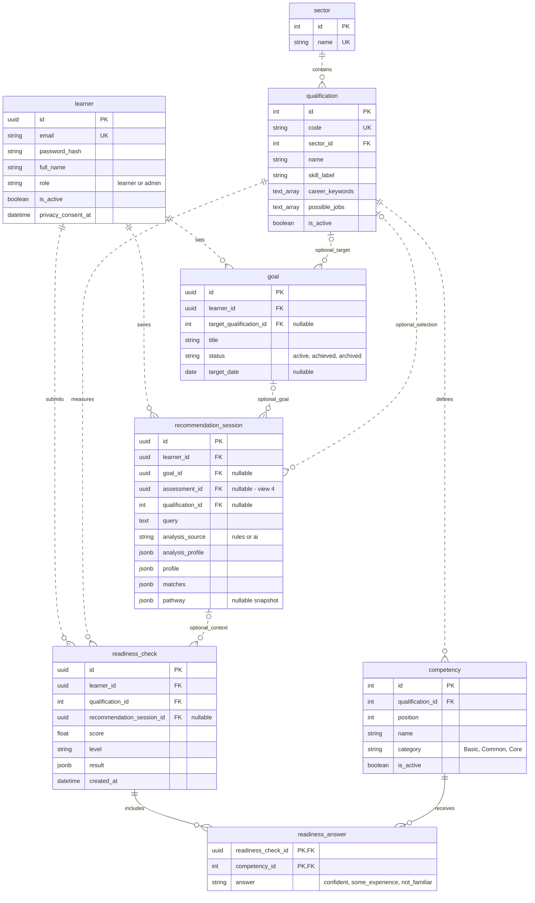
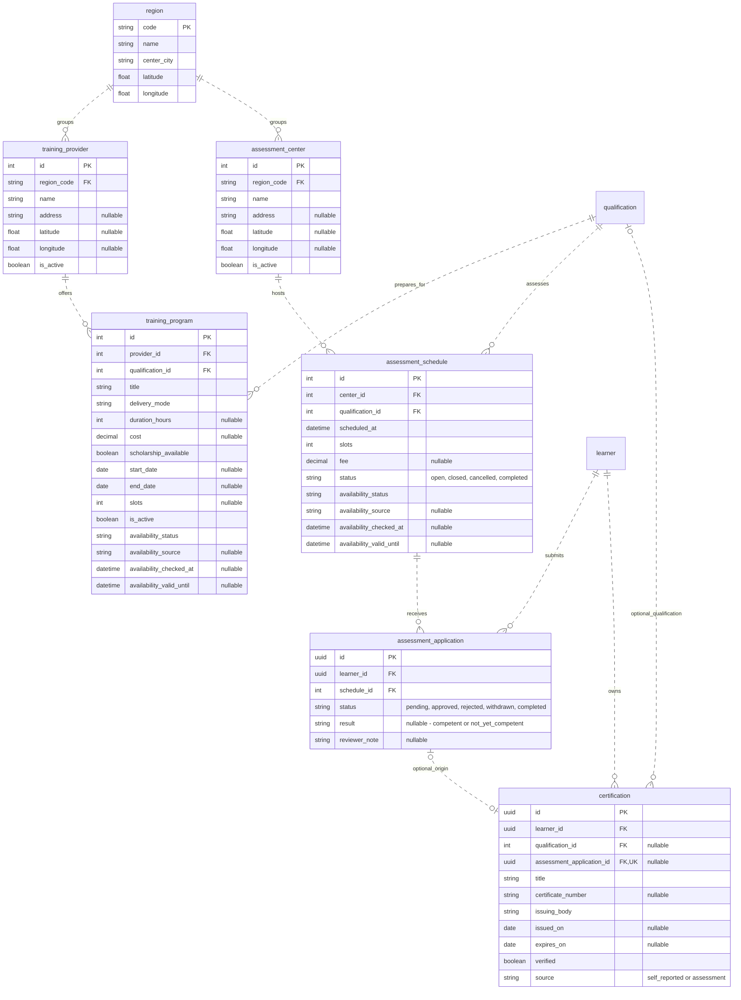
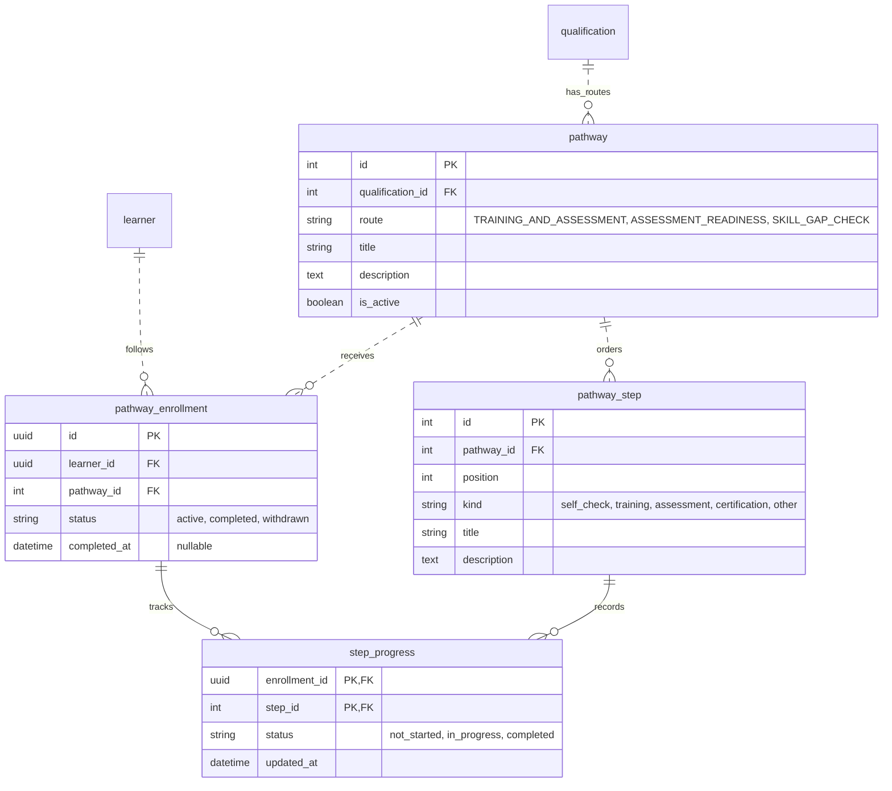
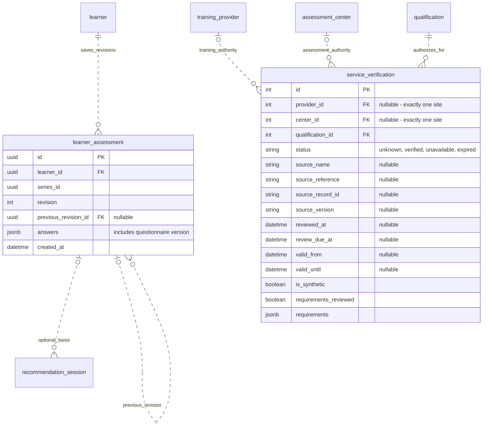
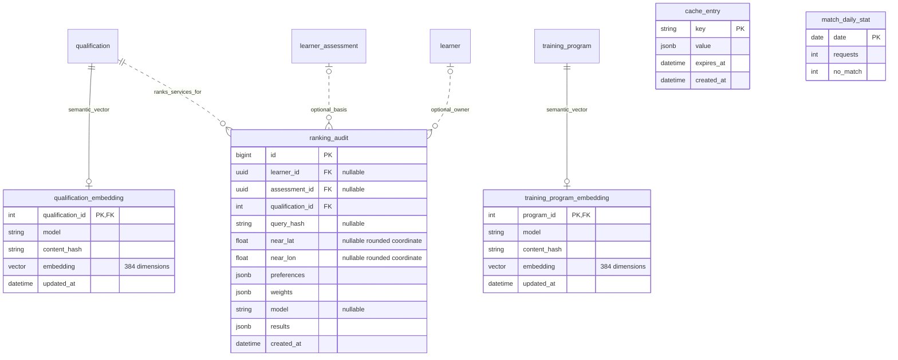

# TESDA-TRACK MVP entity relationship diagram

Prepared 14 October 2026. Companion: [feature list, priorities, and statuses](mvp-features.md).

This ERD follows the project roadmap and user stories, using the current FastAPI/SQLModel models and migrations through `0007` for actual table names and relationships. It covers 26 application tables in five readable views. Tables repeated across views refer to the same entity. Selected business fields are shown; routine timestamps, security counters, and descriptive fields are omitted where they do not clarify a relationship.

The root `30_DATABASE_SCHEMA_MERMAID.md` describes a different Laravel/SSO schema and is not used as the source for this ERD. This document does not change that file or the database. It reflects working-tree definitions, including uncommitted additions, rather than a verified live database.

**Notation:** `PK` = primary key, `FK` = foreign key, `UK` = unique key. In the relationship lines, `||` means exactly one, `o|` means zero or one, and `o{` means zero or many. Dashed lines denote non-identifying relationships; solid lines are used where the parent key is part of the child's primary key. Nullable foreign keys are labelled. Composite keys and uniqueness rules are explained below.

## 1. Catalog, accounts, recommendations, and readiness

Supports F01–F07 and saved personalized recommendations in F19.

Each competency belongs to one qualification in this implementation; there is no qualification/competency junction table. Possible jobs and career keywords are arrays on the qualification, not separate job entities. Each check/competency pair has one answer. Scores and result snapshots are stored on the check; the application validates completeness and qualification consistency.

## 2. Training, assessment applications, and certifications

Supports F08 and F10–F14. `learner` and `qualification` are defined in view 1.

A learner can have at most one application row for each schedule. A single application can be linked to at most one certification; self-reported certifications need no application link. A certificate number itself is not declared unique. An assessment result is allowed only on a completed application. Pending applications do not reserve seats; capacity is checked by the service, with approved/completed applications consuming seats.

Programs and schedules have separate availability evidence. Unknown fees are not zero fees, and a scheduled date is not proof of verified service authority. Providers and assessment centers are separate entities even if one organization performs both roles. PostGIS indexes derive geography from latitude/longitude rather than a separate location table.

## 3. Curated pathways and learner progress

Supports F04 and F13. A pathway enrollment records progress inside TESDA-TRACK, not admission to a training provider.

One pathway exists per qualification/route pair; step positions are unique within a pathway. A learner has at most one enrollment per pathway. Untouched steps have no progress row and are treated as not started. Services must ensure a progress step belongs to the enrollment's pathway; the two independent foreign keys alone do not enforce that relationship.

The JSON `recommendation_session.pathway` is a historical snapshot, not a foreign key to `pathway`.

## 4. Personalized assessments and service verification

Supports F19–F21 and part of US-12. Assessment revisions are learner questionnaires; they are distinct from official exam schedules and readiness checks.

The database requires **exactly one** of `provider_id` and `center_id` per verification row. A site/qualification pair has at most one verification row for its service type. Verified status requires source/review evidence and disallows synthetic data; effective validity and prerequisite decisions also use service logic.

Each assessment series/revision pair is unique. `series_id` groups revisions; it is not a foreign key to an omitted series table. Questionnaire version and normalized input are inside `answers`. The self-reference permits multiple successors at the database level; the assessment service enforces revision workflow rules. Guest questionnaire input is transient and creates no learner-owned record unless explicitly saved.

## 5. Search, ranking audit, caching, and reporting support

Supports F03 and F15–F18, with assessment references supporting F19–F21. These tables support the product but are not separate learner-facing features.

Each qualification/program has at most one current embedding row: its entity ID alone is the primary key, while `model` records which model produced it. The database does not use a composite entity/model key.

Both training and assessment rankings use `ranking_audit`; assessment rankings are identified by `preferences.service_kind = "assessment"`. Results and explanations are JSON snapshots, not foreign-key junction rows for every ranked result. Audit rows store a goal hash rather than raw goal text; saved learner recommendation sessions separately retain their query text. Cache entries and daily aggregate counts have no learner foreign key. Skills Bridge has no imported local skills/occupation tables.

## Constraints and lifecycle rules

| Entity | Database rule |
| --- | --- |
| `learner` | Unique email; role restricted to learner/admin. |
| `qualification` | Unique code; sector reference is required. |
| `competency` | Unique `(qualification_id, position)`; positive position. |
| `readiness_answer` | Composite PK `(readiness_check_id, competency_id)`. |
| `assessment_application` | Unique `(learner_id, schedule_id)`; result requires completed status. |
| `certification` | Unique non-null application reference; expiry cannot precede issue date when both exist. |
| `pathway` | Unique `(qualification_id, route)`. |
| `pathway_step` | Unique `(pathway_id, position)`; positive position. |
| `pathway_enrollment` | Unique `(learner_id, pathway_id)`. |
| `step_progress` | Composite PK `(enrollment_id, step_id)`. |
| `learner_assessment` | Unique `(series_id, revision)`; positive revision. |
| `service_verification` | Exactly one site FK; unique provider/qualification and center/qualification pairs. |
| Embedding tables | One row per referenced qualification/program. |

Deleting a learner cascades to owned goals, assessments, saved sessions, checks, applications, certifications, and pathway enrollments. Child readiness answers and step progress also cascade. Audit learner links use `SET NULL`. Deleting an assessment cascades to linked recommendation sessions and clears audit assessment links; the API deletes an entire revision series. Readiness checks survive deletion of their associated recommendation session because that link uses `SET NULL`.

Deleting a goal clears optional session goal references. Deleting an assessment application clears its certification link. Many catalog/delivery references restrict deletion to protect historical records; qualification records are normally archived with `is_active`. Foreign keys establish references, while service ownership checks ensure a learner cannot attach another learner's records.

## Relationship to proposed features

| Proposed or partial feature | Data-design implication |
| --- | --- |
| Guest journey saving (US-02) | Reuse recommendation sessions and readiness records; no guest-account table is required. |
| Continue journey (US-10) | Reuse saved sessions, pathway progress, and applications; define restoration/ordering behavior. |
| Qualification shortlist (US-05) | Session-only state needs no table. Cross-device persistence would be a separate design. |
| Readiness comparisons (US-11) | Existing checks support history; robust historical comparability may need competency/catalog version snapshots. |
| Source visibility (US-12) | Service verification exists; complete qualification provenance may require additional fields or a related evidence entity. No unimplemented entity is drawn as existing. |
| Interface language (US-15) | Session-only preference needs no table. Account-level persistence would require an explicit addition. |

## Sources

- [Product roadmap](../README.md#roadmap) and [user stories](user-stories.md).
- Model definitions: [catalog](../backend/tesda_track/models/catalog.py), [learners](../backend/tesda_track/models/learners.py), [delivery](../backend/tesda_track/models/delivery.py), [pathways](../backend/tesda_track/models/pathways.py), [learner assessments](../backend/tesda_track/models/learner_assessments.py), [verification](../backend/tesda_track/models/verification.py), [semantic support](../backend/tesda_track/models/semantic.py), and [daily statistics](../backend/tesda_track/models/stats.py).
- [Migrations](../backend/migrations/versions/), [structured assessment behavior](structured-assessments.md), [verification behavior](service-verification.md), and [assessment-center ranking](assessment-center-ranking.md).
