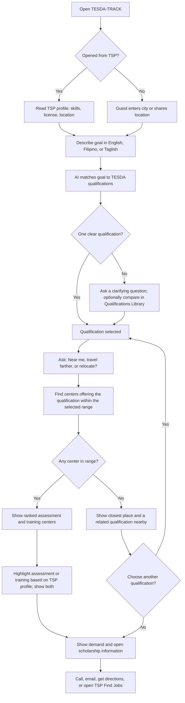

# TESDA-TRACK — Consolidated Product Document

> **Source:** TESDA TRACK (rebuild).pdf  
> **Document date:** November 10, 2026  
> **Document owner shown in source:** Jewel Milagrosa  
> **Purpose:** Consolidates the agreed TESDA-TRACK direction after the November 2026 TESDA demo and team planning. It replaces the earlier overview for the December 2, 2026 presentation.

---

## 1. Executive summary

TESDA-TRACK recommends an appropriate TESDA training or assessment center based on a learner's location and practical ability to travel. It considers:

- Distance to a center.
- Estimated travel time.
- How far the learner is willing or able to travel.
- Whether the learner is willing to relocate.
- Demand for the qualification in the learner's area and other areas they can reach.
- Whether a scholarship is currently open.

**Primary use case:** AI-driven, location-based TESDA Training and Assessment Center Recommendation.

**Problem statement:** How might TESDA ensure the efficiency of identifying the appropriate training and assessment center for each learner?

### The product's change in direction

TESDA-TRACK is now **location-first**. TESDA already provides career guidance through the TESDA Skills Compass and TSP features such as Find My Pathways, Qualifications Library, and Skills Explorer. TSP Maps can show centers, but it does not recommend which center a learner should choose.

TESDA-TRACK therefore focuses on answering:

> **Which center should I go to, and why?**

Finding a qualification is a short supporting step. Career guidance and readiness features remain optional add-ons. The document says that previously built work is not being discarded; the order of the learner journey and the product's core emphasis are changing.

---

## 2. Product positioning and differentiation

TESDA asked the team not to duplicate what the TESDA Skills Compass and TSP already provide. TESDA-TRACK is positioned as an add-on to TSP rather than a replacement for its career-guidance tools.

| Existing tool | What it already does | What TESDA-TRACK adds |
|---|---|---|
| TESDA Skills Compass | Career profiling based on interests, skills, reading, and mathematics, explained by a guidance counselor | Does not repeat career profiling |
| TSP: Find My Pathways, Qualifications Library, Skills Explorer | Career guidance and lists of qualifications | Helps the learner select a qualification quickly |
| TSP Maps | Shows training and assessment centers for a qualification or place | Recommends which center to visit and explains why |
| TSP Find Jobs | Provides job openings | Links to it after showing demand; TESDA-TRACK does not build its own job list |
| **TESDA-TRACK-specific capabilities** | — | Travel time, distance radius, travel/relocation preference, local and other-area demand, open scholarships, and side-by-side training and assessment options |

### Main users

The primary users are learners registered in TSP, including:

- Workers who already have a skill but do not yet have a certificate (for example, someone who can drive and wants to be certified).
- Job seekers who want training for work that is in demand near them.
- Career shifters and lifelong learners pursuing training for livelihood or personal interest, not only for employment.

People without a TSP account can also try the website as guests.

### Value by user group

| User group | Value described in the document |
|---|---|
| Learners | Less time finding an accessible and worthwhile center; a clear choice between training first and going straight to assessment; visibility into where their skill is needed |
| TESDA Planning Office (after December 2) | A view of which qualifications learners want in which areas, compared with demand from ABDD and supply from TSP training records, without waiting for the next survey |
| TESDA centers | Learners arrive already knowing the qualification they want and that the center offers it |

---

## 3. Theory of change

The product's theory of change explains how the inputs and activities are expected to produce outputs, outcomes, and long-term impact, assuming the required conditions hold.

| Level | What it means for TESDA-TRACK | How it will be measured or checked |
|---|---|---|
| **Problem** | Learners can find a qualification but cannot easily tell which center they can reach and whether the trip is worthwhile. TESDA demand data (ABDD) comes from occasional surveys, so some areas may produce too many graduates of one course. | Feedback from TESDA and testers; job-skills mismatch already reported by TESDA |
| **Inputs** | Official center lists with map locations; TSP sign-in and profile; 319 qualifications; demand and scholarship data (sample data for December 2); travel-time service | Approval and loading of each input |
| **Activities** | Match the learner's goal to a qualification; ask how far the learner can go; rank centers; show training and assessment options; show demand; link to TSP Find Jobs | Features delivered in the December 2 release |
| **Outputs** | Ranked and explained center recommendations on a map; demand here and elsewhere; anonymous signals of which qualifications learners want in which areas | Number of recommendations shown; share of searches with at least one center in range |
| **Outcomes** | Learners contact suitable centers sooner; skilled learners go straight to assessment; more learners train where their skill is needed and use open scholarships | Calls, emails, directions taps; “Was this helpful?” responses; later, enrolment and assessment records |
| **Impact** | Fewer job-skills mismatches and less oversupply; the Planning Office compares live demand with supply | Planning Office use of the demand view; supply-versus-demand by qualification and area over time |
| **Assumptions** | Center lists are accurate and approved; TSP provides sign-in and profile data; real demand data becomes available; learners share their location and trust and act on the recommendations | Tracked through the open questions and action items |

### Expected impact chain

1. Approved center, qualification, profile, demand, scholarship, and travel-time data are made available.
2. The learner's goal is matched to a TESDA qualification.
3. The learner states their travel range or willingness to relocate.
4. TESDA-TRACK ranks eligible centers and explains the reasons.
5. Learners contact centers, train, or proceed directly to assessment.
6. Over time, TESDA can compare qualification demand with training supply and reduce job-skills mismatches and oversupply.

The long-term impact depends on the assumptions above, especially data accuracy, approval, and access to real demand data.

---

## 4. User journey

### Example learner

The document uses **Kuya Manuel**, age 31, as its example:

- Registered in TSP.
- Profile lists driving and cooking as skills.
- Has an LTO driver's license.
- Lives in Caloocan City.
- Goal: “Gusto kong maging driver ng truck.”

### End-to-end journey

| Step | What the learner sees or does | Product and implementation notes |
|---|---|---|
| 1. Open TESDA-TRACK | Opens it from TSP and is already signed in. | TRACK reads profile information such as skills, license, and home area. Guests type a city or share their location. |
| 2. Describe the goal | Enters a goal in English, Filipino, or Taglish. | AI matches the learner's words to TESDA qualifications. |
| 3. Pick the qualification | If needed, answers a clarifying question such as “What will you drive?” | Asked only when the goal matches more than one qualification. An optional link can open the Qualifications Library for comparison. |
| 4. Say how far they can go | Chooses “Near me only,” “I can travel farther,” or “I'm willing to relocate.” | Asked before the map. The choice controls the search range and whether other regions with demand are included. |
| 5. See recommended centers | Views a map and ranked list in two groups: assessment centers and training centers. Each result can show distance, travel time, an open-scholarship tag, and demand level. | If the profile shows the skill, assessment centers are highlighted. Training centers are always shown. “Check my readiness” is optional. |
| If nothing is in range | Sees the closest place offering the selected qualification and a related qualification offered nearby. | The learner can choose another qualification and return to the travel-range step. |
| 6. See demand | Sees demand for the skill in their area and, when they can travel or relocate, places with higher demand. A small “Also in demand near you” card may appear. | December 2 uses sample data. Real demand data is expected later from ABDD. Demand is not the same as job openings. |
| 7. Take the next step | Calls, emails, or gets directions to a center, or opens TSP Find Jobs. | Find Jobs is a link to TSP, not a separate TESDA-TRACK job board. |

### Qualification example: driving

The document gives these examples for the clarification step:

| What the learner will drive | Qualification |
|---|---|
| Car or van | Driving NC II |
| Bus or straight truck | Driving (Passenger Bus/Straight Truck) NC III |
| Truck with trailer | Driving (Articulated Vehicle) NC III |

### Journey flow in text form

*Note: The diagram above is a text reconstruction of the journey described in the flowchart and accompanying steps table. It is not a new product requirement.*

---

## 5. How center recommendations work

The document describes a rules-based ranking process for the December 2 release.

1. **Start with the qualification.** Only centers offering the selected qualification are considered, using official TESDA lists.
2. **Apply the learner's range.** “Near me only” limits the search to centers within the selected distance. “I can travel farther” widens the range. “I'm willing to relocate” also includes other areas where the qualification is in high demand.
3. **Rank eligible centers.** Shorter travel time and distance come first. Centers with an open scholarship or higher demand move up the ranking.
4. **Explain the recommendation.** Each result shows why it appears. The example format is: `6 km · about 20 min · scholarship open · demand: medium`.
5. **Show both center types.** Assessment centers and training centers appear in separate groups. The TSP profile determines which group is highlighted, but neither group is hidden because general questions cannot prove that a learner is ready for assessment.
6. **Handle no results in range.** Show the closest place offering the qualification and a related qualification available nearby instead of showing an empty map.

**Important unresolved detail:** The relative weight of distance, travel time, scholarships, and demand has not yet been decided.

### Travel-range choices

- Near me only.
- I can travel farther.
- I'm willing to relocate.

The designs use **25 km** and **100 km** as placeholders for distance limits. The final limits still need to be decided.

---

## 6. AI and machine learning

### Planned AI use for the December 2 release

**Goal-to-qualification matching:**

- A language model further trained on TESDA data turns the learner's words into a “meaning fingerprint.”
- It compares that representation with the 319 TESDA qualifications.
- It is intended to handle English, Filipino, and Taglish. The document's example is matching “driver ng truck” to the appropriate driving qualification.
- It must select only from the official TESDA qualification list.
- When there is no clear match, it should say so rather than guess.

**Center ranking:**

- Uses explicit rules, not AI, for the December 2 release.
- Considers distance, travel time, scholarships, and demand.
- The rules are intended to make each recommendation explainable.

**Possible later AI uses:**

- Learn from “Was this helpful?” responses.
- Predict which centers and qualifications lead to jobs once TESDA outcome data is available.

### AI hosting and wording

- The AI runs on TESDA-TRACK's own server.
- Learner goals are not sent to an outside AI company.
- The document's privacy safeguards state that goals are not logged.
- On-screen use of the term **“AI”** is postponed until TESDA experts review the test examples.
- If the model is unavailable, a word-matching backup takes over.

---

## 7. December 2, 2026 release scope

The document defines **Must have** as a feature required for release. **Add-on** means a feature that is already built or relatively simple, supports the core experience, and is the first to be cut if time runs out.

### Must-have features

| Area | Feature | Learner-facing behavior | Status stated in the document |
|---|---|---|---|
| Getting in | Open from TSP | Open TESDA-TRACK from TSP without leaving it | Waiting on the TSP team |
| Getting in | Sign in with TSP (SSO) | Already signed in with TSP ID; profile is read | Not built; needs the TSP team |
| Getting in | Guest-only website | Use without an account; type a city or share location | Guest use works; sign-in and sign-up still need to be removed |
| Getting in | Privacy notice placeholder | Short pop-up explaining what data is used | Built; legal review is planned after December 2 |
| Qualification | Describe my goal | Enter a goal in English, Filipino, or Taglish | Working |
| Qualification | Pick the right qualification | Choose between close matches, such as the three driving qualifications | Matching works; the choice step is new |
| Location | How far can you go? | Choose near me, travel farther, or relocate before the map | Not built |
| Location | Recommended centers with reasons | View ranked map and list in two groups, with distance, travel time, scholarship, and demand | Map and list work; ranking is not built |
| Location | Training and assessment side by side | Always see both; TSP profile highlights one | Partly built |
| Location | Travel time | See an estimate such as “about 25 min by car” for each center | Not built; requires a routing service |
| Location | Every center on the map | See a pin and distance for every center | About 670 centers still need their location fixed |
| Location | Nothing in range | See the closest place and a related qualification nearby | Not built |
| Location | Center details and directions | View address, phone, and email; call, email, or get directions | Working |
| Location | Official, labelled data | Only real TESDA listings, each with its source and date | Lists loaded; TESDA approval pending |
| Demand | Demand in the area | See high, medium, or low demand here and, if the learner can travel, elsewhere | Not built; sample data is available |
| Demand | Open scholarships | Show “Scholarship open” only while one is open | Not built; sample data is available |
| Whole app | Accurate wording | Make no claims the product cannot support | Not done |
| Whole app | Works well on laptops and phones | Every screen fits and works on slow internet | Still needs checking |

### Add-on features

| Feature | Learner-facing behavior | Status stated in the document |
|---|---|---|
| Check my readiness | Rate one's own skills for a qualification | Working |
| Qualifications Library | Browse all 319 qualifications or compare similar ones | Working |
| Also in demand near you | Small card showing two or three other qualifications in demand nearby | Not built; sample data is available |
| TSP Find Jobs link | Open TSP Find Jobs for the selected skill and area | Not built; needs the link from TSP |
| Skills Explorer | Explore skills and related jobs from the menu | Working; not part of the demo |

### Explicitly out of scope for December 2

| Not included | Reason | Timing stated in the document |
|---|---|---|
| Career guidance and career profiling | Already covered by TESDA Skills Compass and TSP | Not planned |
| Real demand data (ABDD) and live scholarship data | Not yet available to the team; sample data will be used for December 2 | Next phase |
| TESDA-TRACK's own job list | Jobs belong to TSP Find Jobs and another group's use case | Not planned |
| Official privacy notice | Legal review follows December 2 | After December 2 |
| Seat counts, schedules, and center capacity | No live data feed | Future |
| Planning Office demand dashboard | Internal use; real data is needed first | After December 2 |
| Email/password sign-in or sign-up | Accounts come from TSP SSO; website is guest-only | Not planned |
| Screen reader support, Filipino screens, and saving a journey | Not part of the December 2 goal | Later |

---

## 8. Delivery and access model

TESDA-TRACK is a web app.

### Intended delivery path

- **December 2:** Open from TSP as a web page inside the TSP app (a web view).
- **After December 2:** Become a built-in TSP feature connected to TSP Maps.

### Access modes described

| Way in | How it works | Readiness stated in the document |
|---|---|---|
| From TSP (signed in) | The learner is already signed in to TSP. TESDA-TRACK opens with the TSP ID and reads profile information such as skills, license, and location. If sign-in fails, a Retry message appears. | Waiting for the TSP team to set up SSO |
| Website (guest) | No account, sign-in, or sign-up. The learner types a city or shares their location. Nothing is saved after the tab closes. | Guest use works; sign-in and sign-up still need to be removed |

### Unresolved delivery decision

The November 10 planning discussion suggested presenting December 2 as a plain website with sample TSP data, not yet connected to TSP. The current plan in the document is a web view inside TSP with SSO. The team still needs to decide which setup will be used.

---

## 9. Data sources and sample data

| Data | Source | December 2 plan | Later plan |
|---|---|---|---|
| Training and assessment centers | Official TESDA lists: about 4,486 training providers and 2,699 assessment centers; most have map coordinates | Real data, pending TESDA approval; about 670 centers need their location fixed | Regular updates from the TESDA data office |
| Qualifications | 319 TESDA qualifications | Real data | Keep up to date |
| Learner profile | TSP (skills, license, location) | Through SSO, or sample TSP profiles if the demo is a plain website | Live from TSP |
| Demand per qualification and area | TESDA ABDD planning data | Sample data, labelled on screen | Real ABDD data with Planning Office approval |
| Scholarships | TESDA scholarship programs | Sample data; show only while “open” and label on screen | Live scholarship data |
| Travel time | Routing service | Service still to be chosen | Same service or approach |
| Jobs | TSP Find Jobs | Link only | Link only |

### Data presentation and privacy notes

- Every screen using sample data must say that the data is sample data.
- Learner location is rounded to approximately **1 km** and is not saved.
- For guest use, nothing is saved after the browser tab closes.

---

## 10. AI governance, risks, and safeguards

TESDA-TRACK provides guidance, not decisions. It recommends centers; the learner makes the final choice.

| Area | What could go wrong | Safeguards already in place | Safeguards to add | Owner |
|---|---|---|---|---|
| People | A learner trusts an incorrect qualification match or poor center recommendation | Every result shows its reason; weak matches are labelled; the system says “no clear match” instead of guessing; training and assessment options are both shown | Name an AI owner; add “Was this helpful?” and “Report a wrong suggestion”; show: “This is a suggestion. Confirm with the center or your TESDA office.” | Product Owner |
| Data | Incomplete or sample data produces misleading recommendations | Use official TESDA center lists; show source and date on every listing; label sample demand and scholarship data | Fix missing center locations; check coverage by region and language; prepare a one-page fact sheet explaining what the AI was trained on and its limits | Developers with TESDA experts |
| Launch and operation | Results with real learners are worse than in testing | AI selects only from the official list; a word-matching backup takes over if the model is down | Start with a limited group or one region; check “no match” rates and feedback weekly; agree on a stop rule | Product Owner and developers |
| Privacy and openness | Learners do not understand how results are made or where their data goes | AI runs on TESDA-TRACK's own server; goals are not logged; location is rounded to about 1 km and not saved; a placeholder privacy notice exists | State on screen that results come from automatic matching and ranking; complete legal review of the privacy notice after December 2 | Product Owner |

---

## 11. Open questions and decisions needed

| Open question | Decision owner(s) | Needed by / status |
|---|---|---|
| December 2 setup: inside TSP with SSO, or a plain website with sample TSP data? | Product Owner with TSP team | Before the next sprint |
| How should distance, travel time, scholarships, and demand be weighted in center ranking? | Product Owner with developers | Before development starts |
| What distance limits should apply to “Near me only” and “I can travel farther”? The designs currently use 25 km and 100 km as placeholders. | Product Owner | Before development starts |
| Which routing service should provide travel time, which travel modes should be supported, and what will it cost? | Product Owner with developers | Before development starts |
| Where will sample demand and scholarship data come from, and how will it be labelled? | Product Owner with developers | Before development starts |
| Who at TESDA owns and approves the center lists? | Product Owner and TESDA data office | Overdue |
| Where will TESDA-TRACK be hosted, and who will pay? | TESDA ICT and Sponsor | Overdue |

---

## 12. Action items

| Action | Why it matters | Owner |
|---|---|---|
| Update the pitch with the new problem statement, location-first story, and theory of change | TESDA asked the team not to repeat the Skills Compass and TSP | Product Owner |
| Confirm the web view and SSO with the TSP team, and obtain the TSP Find Jobs link | Sign-in, profile access, and the jobs link depend on TSP | Product Owner |
| Obtain an official domain to replace `tesda-track.vercel.app` | TSP needs a fixed, trusted address for the web view and SSO | Product Owner with TESDA ICT |
| Prepare sample TSP profiles, demand per qualification and area, and open-scholarship data | Demand and scholarships cannot be shown on December 2 without sample data | Developers |
| Build “How far can you go?”, ranking, travel time, and the “nothing in range” case | These are core parts of the revised learner journey | Developers |
| Fix the approximately 670 centers without map locations | Missing coordinates prevent pins, distance, and travel-time calculations | Developers with TESDA data office |
| Obtain TESDA approval to use the center lists | Center recommendations depend on approved lists | Product Owner with TESDA data office |
| Ask the Planning Office what ABDD demand data can be shared after December 2 | Needed to replace sample demand data | Product Owner |
| Have TESDA experts review the placeholder questions and AI test examples after December 2 | Confirms results before “AI” wording is used | Product Owner |
| Name the AI owner and add “Was this helpful?” and “Report a wrong suggestion” | Establishes accountability and a quality signal | Product Owner and developers |
| Remove or reword unapproved claims on screen | Learners must be able to trust what TESDA-TRACK says | Developers, approved by the Product Owner |

---

## 13. Glossary

| Term | Meaning in the document |
|---|---|
| **TSP** | TESDA Skills Passport, the TESDA app learners are registered in |
| **Web view** | A web page shown inside the TSP app, so the learner does not leave it |
| **SSO (single sign-on)** | Being signed in to TSP also signs the learner in to TESDA-TRACK using the TSP ID |
| **Qualification** | A TESDA certificate a learner can train or be assessed for, such as Driving NC II |
| **Training center (TC)** | A school or institution that offers training for a qualification |
| **Assessment center (AC)** | An accredited place where learners take the test to get certified |
| **Demand** | How much a qualification is needed in an area; it is not the same as a job opening |
| **ABDD** | TESDA planning data about which skills areas need; intended future source of real demand data |
| **Relocate** | Move to another area to train, get assessed, or work |
| **TESDA Skills Compass** | TESDA's career-profiling test, explained by a guidance counselor |
| **Theory of change** | How the product's activities are expected to lead to the result TESDA wants, and what must hold true |
| **Sample data** | Made-up data used for the demo, labelled on screen until real data is available |

---

## 14. Analysis and key observations

This section synthesizes implications from the source document. It does not introduce new product commitments.

### 14.1 The strategic focus is now much narrower and clearer

The strongest product decision is the shift from broad career guidance to a specific location-based decision: **which eligible training or assessment center is practical for this learner to reach?** This gives TESDA-TRACK a clearer role alongside the Skills Compass, TSP qualifications tools, TSP Maps, and TSP Find Jobs.

### 14.2 The location recommendation journey is the critical path

The qualification-matching step supports the location feature; it is not the main product outcome. The release depends on the following chain working end to end:

1. Identify the intended qualification accurately.
2. Determine the learner's acceptable travel range.
3. Have accurate center coordinates and qualification offerings.
4. Calculate travel time and distance.
5. Rank centers using approved, explainable rules.
6. Display demand and scholarship information with clear labels.
7. Provide usable center contact and direction actions.

A failure in center coordinates, routing, qualification offerings, or the ranking rules directly weakens the core promise.

### 14.3 The December 2 scope has material delivery dependencies

The source marks many central location features as must-have while also stating that several are not built or only partly built. The main dependencies called out are:

- TSP team support for SSO and the web view, if the integrated route is chosen.
- TESDA approval and ownership of the official center lists.
- Fixing the locations of approximately 670 centers.
- Selecting and configuring a routing service.
- Finalizing travel-range limits and ranking weights.
- Preparing clearly labelled sample demand, scholarship, and possibly TSP profile data.

The unresolved choice between an integrated TSP web view and a plain demo website also affects the access flow and available profile data.

### 14.4 Recommendation explainability is a core product requirement

The product is expected to explain why a center is recommended, not simply display a ranked list. The sample explanation combines distance, travel time, scholarship status, and demand. However, the document leaves the factor weights undecided. The ranking policy therefore needs to be agreed before implementation can be considered complete and consistent.

### 14.5 Data quality is as important as the AI model

The document limits AI to matching a learner's goal to one of the 319 official qualifications. Center ranking remains rules-based. The usefulness of the final recommendation still depends heavily on correct center listings, qualification offerings, map coordinates, travel-time data, demand data, and scholarship status. Fixing incomplete center locations and getting TESDA approval are therefore core delivery tasks, not merely data-cleanup work.

### 14.6 Sample data must not be mistaken for operational data

Demand and scholarship information for December 2 is sample data, and learner profiles may also be simulated if the demo is a plain website. The source explicitly requires sample data to be labelled on every screen where it appears. This distinction is important for the demonstration and for user trust.

### 14.7 Privacy and governance are part of the user experience

The stated safeguards include TESDA-TRACK's own-server AI operation, no logging of learner goals, approximate 1 km location rounding, and no location retention. The document also calls for a clear explanation that the results are generated through automatic matching and ranking, a reviewed privacy notice, an accountable AI owner, and learner feedback/reporting controls.

### 14.8 Success measures extend beyond showing recommendations

The theory of change identifies several levels of measurement:

- **Immediate product use:** number of recommendations shown and searches with at least one center in range.
- **Learner action:** calls, emails, directions taps, and “Was this helpful?” feedback.
- **Longer-term outcomes:** enrolment and assessment records.
- **System-level impact:** Planning Office use of demand information and supply-versus-demand analysis by qualification and area.

The document does not provide numerical targets for these measures.

---

## 15. Items that should be treated as unresolved (not assumed)

For implementation and planning, the following points should remain open until the responsible owners confirm them:

- Whether the December 2 presentation will use TSP web view + SSO or a standalone guest website with sample TSP data.
- Final ranking weights for distance, travel time, scholarships, and demand.
- Final distance thresholds for the travel choices; 25 km and 100 km are placeholders only.
- Routing provider, travel modes, and cost.
- Approved source and labelling rules for sample demand and scholarship data.
- TESDA owner and approval for official center lists.
- Hosting location and funding.
- Whether the December 2 demo can rely on the integrated TSP profile or must use sample profiles.

---

## 16. Source limitations and fidelity notes

- This Markdown is a structured conversion and analysis of the supplied 18-page PDF. The original document's meaning and terminology have been retained as closely as possible.
- The source's user-journey flowchart has been converted into a Mermaid flowchart and a step table. This is a text reconstruction, not an exact reproduction of the original diagram's visual layout.
- The source refers to five web app screen designs on a design canvas, but the PDF does not include enough screen-level content to document those designs in detail here.
- The PDF describes sample demand and scholarship data but does not specify the actual sample records or their source in the sections provided.
- The document does not specify final ranking weights, distance thresholds, routing provider, hosting arrangement, or final December 2 integration choice. These have been kept as open questions rather than filled in.

